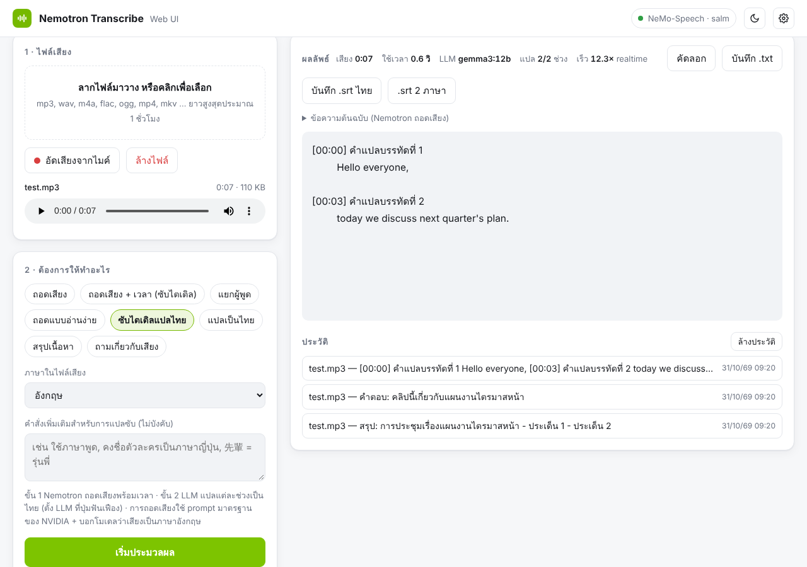

# Nemotron Transcribe Web UI

หน้าเว็บสำหรับถอดเสียงด้วย **NVIDIA Nemotron 3.5 Transcribe** บนเครื่องตัวเอง — **รันบน Windows ได้เลย ไม่ต้องใช้ WSL**
clone ลงเครื่องแล้วดับเบิลคลิก `start.bat` ไฟล์เดียว ระบบจะติดตั้งตัวรันโมเดล ดาวน์โหลดโมเดลที่เหมาะกับการ์ดจอ
แล้วเปิดหน้าเว็บที่ **http://localhost:8090** ให้เอง



## ความสามารถ

- อัปโหลดหรือลากไฟล์เสียง/วิดีโอมาวาง (mp3, wav, m4a, flac, mp4 …) ยาวสูงสุดประมาณ 1 ชั่วโมง หรืออัดจากไมค์
- ถอดเสียง / **มีเวลากำกับ + ส่งออกซับไตเติล .srt** / แยกผู้พูด / ถอดแบบอ่านง่าย / แปลเป็นไทย / สรุป / ถามคำถามเกี่ยวกับเสียง
- รองรับภาษาไทย (ตามเอกสารของ NVIDIA) — เลือกภาษาในไฟล์ได้ เพราะโมเดลไม่ได้ตรวจจับภาษาเอง
- ข้อความขึ้นแบบ real-time, คัดลอก / บันทึก `.txt`, เก็บประวัติในเบราว์เซอร์, โหมดมืด, ใช้บนมือถือในวง LAN ได้
- ทุกอย่างรันในเครื่อง ไฟล์เสียงไม่ถูกส่งออกนอกเครื่อง
- ใช้พอร์ต 8090 จึงเปิดพร้อม Open WebUI (8080) ได้

## ทำงานยังไง

```
เบราว์เซอร์ ──► Web UI (พอร์ต 8090) ──► NVIDIA NeMo-Speech.cpp + โมเดล GGUF (พอร์ต 8000)
```

ตัวรันโมเดลคือ [NeMo-Speech.cpp](https://github.com/NVIDIA/NeMo-Speech.cpp) ของ NVIDIA ซึ่งเป็นโปรแกรม C++ ที่รันบน Windows โดยตรง
และรองรับ Nemotron 3.5 Transcribe ในรูปแบบไฟล์ GGUF

## สิ่งที่ต้องมี

| | |
|---|---|
| ระบบ | Windows 10/11 64-bit |
| การ์ดจอ | NVIDIA + ไดรเวอร์ล่าสุด แนะนำ VRAM 24 GB ขึ้นไป (ดูตารางด้านล่าง) |
| พื้นที่ดิสก์ | 25–40 GB สำหรับไฟล์โมเดล (เก็บใน `models\` ของโปรเจกต์) |
| โปรแกรม | [Git](https://git-scm.com/download/win) และ [Python 3.10+](https://www.python.org/downloads/windows/) แบบ **64-bit** (*Windows installer (64-bit)*, ติ๊ก *Add python.exe to PATH*) — แบบ 32-bit ก็ใช้ได้ แต่แนะนำ 64-bit |

`start.bat` เลือกไฟล์โมเดลตามการ์ดจออัตโนมัติ:

| การ์ดจอ | ไฟล์ที่เลือก | ยาวสุดต่อไฟล์ |
|---|---|---|
| RTX 50xx / RTX PRO (Blackwell) 32 GB ขึ้นไป | **NVFP4** (เร็วที่สุด) | 1 ชั่วโมง |
| RTX 50xx (Blackwell) 12–24 GB เช่น 5070 Ti / 5080 | **NVFP4** บนการ์ดจอ ส่วนที่ไม่พอไดรเวอร์ NVIDIA ย้ายไป RAM ให้ (ต้องเปิด *CUDA Memory Fallback*) | 1 ชั่วโมง |
| 32–48 GB รุ่นอื่น | รุ่นที่ใหญ่ที่สุดที่ลงได้ (Q5/Q8) | 1 ชั่วโมง |
| 24 GB (เช่น RTX 3090/4090) | IQ4_NL + ตั้งค่าประหยัดหน่วยความจำ | ประมาณ 29 นาที |
| การ์ดรุ่นอื่นต่ำกว่า 20 GB หรือไม่มีการ์ด NVIDIA | IQ4_NL **รันบน CPU + RAM** (ช้ากว่ามาก, ต้องมี RAM ~32 GB) | 1 ชั่วโมง |

### การ์ดจอเล็กกว่า 24 GB

โมเดลนี้ (30B) ไฟล์เล็กที่สุดคือ IQ4_NL ประมาณ 19 GB + encoder 1.7 GB + หน่วยความจำทำงาน — **ใส่การ์ด 16 GB ไม่ได้**
และ NeMo-Speech.cpp ยังไม่มีตัวเลือกแบ่งเลเยอร์ไป CPU แบบ llama.cpp (`-ngl`) ทางเลือกคือ:

1. **รันบน CPU** (`start.bat` เลือกให้อัตโนมัติ) — ต้องมี RAM ประมาณ 32 GB ขึ้นไป ใช้ได้แต่ช้ากว่า GPU มาก
2. **ใช้ model server เครื่องอื่น** ที่มีการ์ด 24 GB ขึ้นไป (หรือเช่า cloud GPU) แล้วตั้ง `MODEL_URL` และ `START_SERVER=0`
3. **ให้การ์ดจอประมวลผล แล้วให้ไดรเวอร์ NVIDIA ล้นไปใช้ RAM** (ค่าเริ่มต้นสำหรับการ์ด Blackwell 12 GB ขึ้นไป) —
   ไดรเวอร์ NVIDIA บน Windows (536.40 ขึ้นไป) ย้ายส่วนที่ไม่พอใน VRAM ไปไว้ใน RAM ระบบผ่าน PCIe ให้เอง
   - NVIDIA app → Graphics → Global Settings → **CUDA Memory Fallback** = **Driver Default** หรือ **Prefer fallback**
     (NVIDIA Control Panel: Manage 3D settings → *CUDA - Sysmem Fallback Policy*) — ห้ามตั้ง *Prefer no fallback*
   - การ์ดรุ่นอื่นลองได้ด้วย `set "DEVICE=cuda:0"` ใน `config.local.bat`
   - ความเร็วขึ้นกับว่าไดรเวอร์ย้ายส่วนไหนไป RAM — ลองไฟล์สั้นเทียบตัวเลข ×realtime กับโหมด CPU (`set "DEVICE=cpu"`)
4. **โมเดลเล็ก Nemotron 3.5 ASR Streaming 0.6B** รันบนการ์ด 16 GB สบาย แต่ภาษาไทยอยู่ในกลุ่มที่ NVIDIA ระบุว่า
   ต้อง fine-tune ก่อนใช้งานจริง — ไม่แนะนำสำหรับภาษาไทย

## เริ่มใช้งาน

```bat
git clone https://github.com/Tumzzz000/nemotron-transcribe-webui.git
cd nemotron-transcribe-webui
start.bat
```

หรือดับเบิลคลิก `start.bat` ใน File Explorer ก็ได้

`start.bat` จะทำตามลำดับ:

1. สร้าง Python environment และติดตั้งแพ็กเกจของหน้าเว็บ
2. ติดตั้ง NeMo-Speech.cpp ด้วยตัวติดตั้งทางการของ NVIDIA ไปที่ `%LOCALAPPDATA%\Programs\NeMoSpeech`
3. ดาวน์โหลดไฟล์โมเดล (ครั้งแรก 20–35 GB, ถ้าเน็ตหลุดรันใหม่จะโหลดต่อจากเดิม)
   แล้วเปิดหน้าต่าง **Nemotron model server** — รอโหลดโมเดลเข้าการ์ดจอสักครู่
4. เปิดหน้าเว็บ http://localhost:8090 — ไฟมุมขวาบนเป็นสีเขียวเมื่อโมเดลพร้อม (หน้าเว็บตรวจให้เองทุก 5 วินาที)

ข้อ 1–3 ทำแค่ครั้งแรก ครั้งต่อไปเปิดได้ภายในไม่กี่นาที

ปิดใช้งาน: ปิดหน้าต่าง **Nemotron model server** และ **Nemotron Transcribe**

อัปเดตเวอร์ชันใหม่:

```bat
git pull
```

## การตั้งค่า

คัดลอก `config.example.bat` เป็น `config.local.bat` แล้วแก้ค่า (ไฟล์นี้ไม่ถูก git track จึงไม่หายตอน `git pull`)

| ตัวแปร | ค่าเริ่มต้น | ความหมาย |
|---|---|---|
| `WEBUI_PORT` | `8090` | พอร์ตหน้าเว็บ |
| `MODEL_PORT` | `8000` | พอร์ตของ model server |
| `MODEL_URL` | `http://localhost:8000` | ใช้ model server ที่รันอยู่เครื่องอื่น |
| `START_SERVER` | `1` | `0` = เปิดแค่หน้าเว็บ |
| `MODEL_DIR` | `models\` ในโปรเจกต์ | ที่เก็บไฟล์โมเดล |
| `MODEL_QUANT` | เลือกตามการ์ดจอ | บังคับชนิดไฟล์ เช่น `NVFP4`, `IQ4_NL`, `Q8_0` — รัน `start.bat` ใหม่แล้วจะดาวน์โหลดและสลับให้เอง |
| `GGUF_REPO`, `MODEL_FILE` | เลือกให้อัตโนมัติ | เลือก repo / ชื่อไฟล์โมเดลเอง |
| `HF_TOKEN` | — | token ของ Hugging Face ถ้าการดาวน์โหลดขอ |
| `NS_CHANNEL` | `nightly` | รุ่นของ NeMo-Speech.cpp — ต้องเป็น `nightly` เพราะรุ่น stable 0.2.0 ยังรันโมเดลนี้ไม่ได้ |
| `HOST` | `127.0.0.1` | `0.0.0.0` = ให้มือถือ/เครื่องอื่นในวง LAN เปิดหน้าเว็บได้ |
| `BACKEND` | `nemo` | `vllm` = ใช้ vLLM ใน WSL2 แทน (ดูด้านล่าง) |

ถ้าอยากเปลี่ยนไฟล์โมเดล ให้ลบ `models\selected.bat` แล้วรัน `start.bat` ใหม่

## ทางเลือก: vLLM ใน WSL2 / Linux

สำหรับเครื่องที่อยากใช้ checkpoint ต้นฉบับจาก Hugging Face (BF16/FP8/NVFP4) ผ่าน vLLM:
ตั้ง `BACKEND=vllm` ใน `config.local.bat` (ต้องมี WSL2 + Ubuntu) หรือบน Linux:

```bash
./server/start-vllm.sh   # หน้าต่างที่ 1: ติดตั้ง vLLM (ครั้งแรก) และรันโมเดล
./start.sh               # หน้าต่างที่ 2: หน้าเว็บที่ http://localhost:8090
```

### WSL troubleshooting

ถ้า WSL ขึ้น `WSL installation appears to be corrupted (... REGDB_E_CLASSNOTREG)` ให้เปิด PowerShell แบบ Administrator:

1. `wsl --update --web-download` แล้วรีสตาร์ทเครื่อง
2. ถ้ายังไม่หาย: `dism.exe /online /enable-feature /featurename:Microsoft-Windows-Subsystem-Linux /all /norestart`
   และ `dism.exe /online /enable-feature /featurename:VirtualMachinePlatform /all /norestart` แล้วรีสตาร์ท
3. ถ้ายังไม่หาย: ถอน *Windows Subsystem for Linux* ใน Settings → Apps แล้วติดตั้งจาก https://github.com/microsoft/WSL/releases
4. ติดตั้ง Ubuntu: `wsl --install -d Ubuntu` แล้วตรวจด้วย `wsl -e echo ok` และ `wsl -e nvidia-smi`

## โครงสร้างโปรเจกต์

```
start.bat              ตัวเริ่มทุกอย่างบน Windows
config.example.bat     ตัวอย่างการตั้งค่า
app.py                 web server (FastAPI): แปลงเสียงเป็น WAV 16 kHz แล้วส่งต่อให้ model server
static/index.html      หน้าเว็บ
tools/get_model.py     ตรวจการ์ดจอ เลือกและดาวน์โหลดไฟล์ GGUF, เขียนค่าตั้งของ server
server/                สคริปต์ vLLM สำหรับ WSL2/Linux (ทางเลือก)
start.sh               เปิดหน้าเว็บบน Linux/macOS
```

## ข้อจำกัดที่ควรรู้

- ทดสอบหน้าเว็บกับ server จำลองตามเอกสาร API ของ NeMo-Speech.cpp แล้ว แต่ยังไม่ได้ทดสอบกับโมเดลจริงบนทุกการ์ดจอ
- ไฟล์โมเดลดาวน์โหลดจาก repo GGUF ทางการของ NVIDIA ถ้ามี ไม่งั้นใช้ repo ที่ชุมชนแปลงไว้
  (`AtomicChat/NVIDIA-Nemotron-3.5-Transcribe-30B-A4B-GGUF`) — เปลี่ยนได้ด้วย `GGUF_REPO`
- Prompt ของแต่ละปุ่มอิงจาก [เอกสาร prompt ของ NVIDIA](https://github.com/NVIDIA/NeMo-Speech.cpp/blob/main/docs/salm/prompts.md)
  แก้ได้ในช่อง Prompt หรือที่ `PRESETS` ใน `static/index.html`

## เครดิต

โมเดล [NVIDIA Nemotron 3.5 Transcribe](https://huggingface.co/nvidia/NVIDIA-Nemotron-3.5-Transcribe-30B-A4B) (OpenMDW-1.1)
และ [NeMo-Speech.cpp](https://github.com/NVIDIA/NeMo-Speech.cpp) (Apache-2.0) เป็นของ NVIDIA —
โปรเจกต์นี้เป็นแค่หน้าเว็บและตัวติดตั้งสำหรับเรียกใช้ ไม่ได้มาจาก NVIDIA
